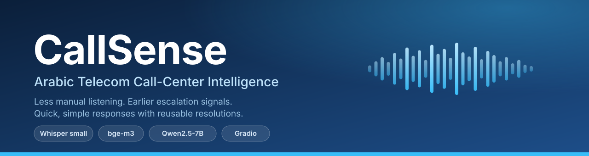
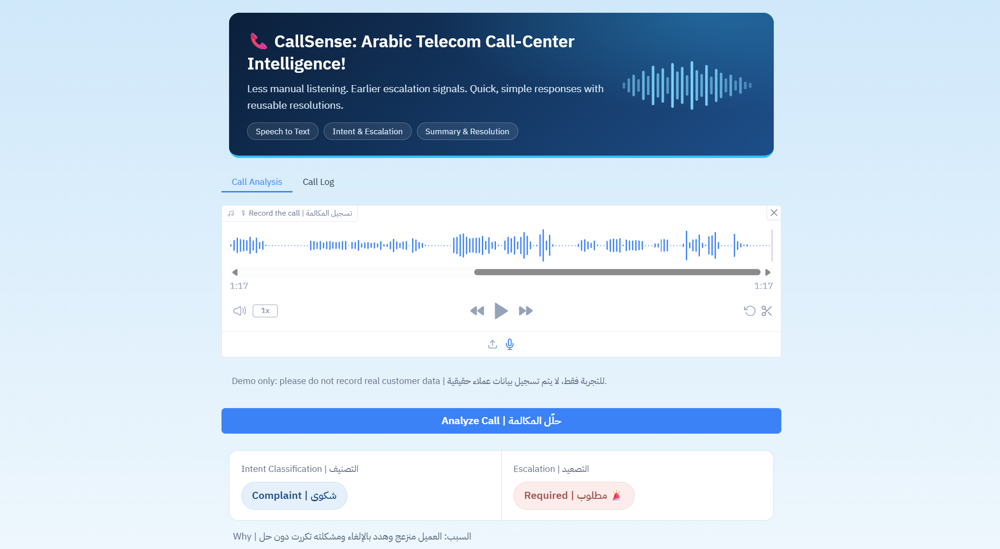
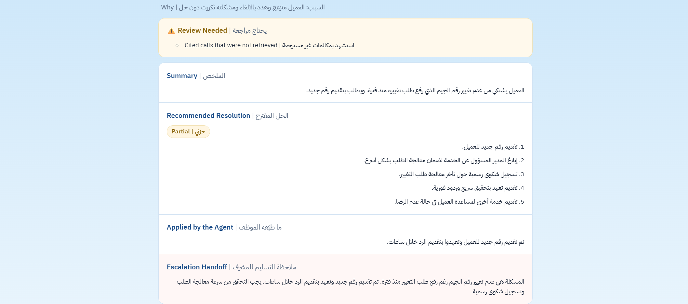
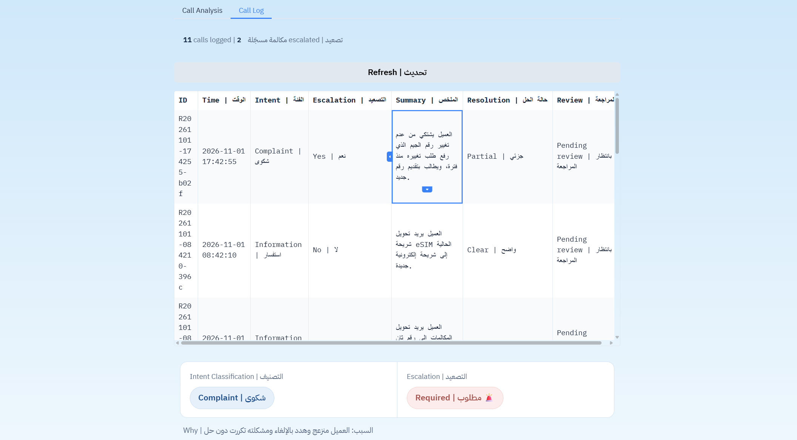
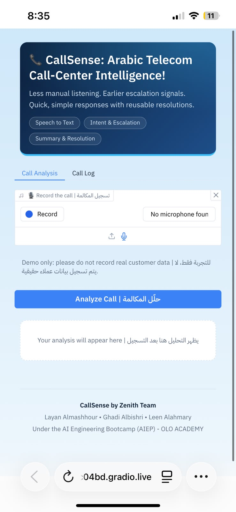
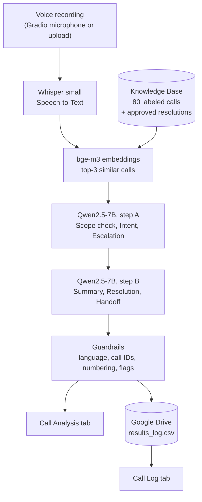

<p align="center">
  
</p>

<p align="center">
  <a href="https://colab.research.google.com/github/LayanAlmashhourCodes/CallSense/blob/main/notebooks/CallSense_Backend.ipynb"></a>
  
  
  
  
  
  
  
</p>

<p align="center">
  <b>Record a call. Get the transcript, intent, escalation decision, summary and a reusable resolution in about a minute.</b>
</p>

<details>
<summary><b>🇸🇦 نبذة بالعربية</b></summary>

<div dir="rtl">

**CallSense** نظام ذكاء اصطناعي يحلل مكالمات خدمة العملاء في شركة اتصالات. يسجّل المستخدم مكالمة من المتصفح، فيحوّلها **Whisper** إلى نص، ثم يبحث النظام عن أقرب مكالمات مصنّفة سابقًا، ويحدد **Qwen2.5-7B** تصنيف المكالمة وهل تحتاج **تصعيدًا**، ويكتب **الملخص** و**الحل المقترح**. تظهر النتيجة في صفحة ويب (Gradio) برابط عام، وتنحفظ كل مكالمة في **سجل** على Google Drive ليستفيد منه محللو الجودة والمدراء.

الهدف: **تقليل الاستماع اليدوي**، و**الإنذار المبكر بالتصعيد**، و**حلول سريعة قابلة لإعادة الاستخدام**.

</div>
</details>

---

## What it does

| | |
|---|---|
| 🎙 **Record in the browser** | Record, pause and resume, or upload an audio file. No app to install |
| 📝 **Arabic speech-to-text** | Whisper small, with a tuned decoding setup and a repetition guard |
| 🏷 **Intent classification** | `billing` · `technical` · `cancellation` · `complaint` · `information` · `out_of_scope` |
| 🚨 **Escalation decision** | Flags calls that need a supervisor, with a ready handoff note |
| 🧾 **Summary and resolution** | Grounded in similar past calls (RAG), including human-approved resolutions |
| 🛡 **Guardrails** | Language check, call-ID normalization, and "Review Needed" flags for real issues |
| 📚 **Call Log** | Every analysis is stored on Google Drive and shown in a live table with full reports |
| 🌐 **Public link** | Anyone with the link can try it from any device |

## 🎬 Demo

> The public link is **temporary** and only works while the notebook is running. To try it yourself, [open the notebook in Colab](#-quick-start) and run it. It takes about 10 minutes on a free GPU.

<p align="center">
  
</p>
<p align="center">
  
</p>
<p align="center">
  
  
</p>

## 🧠 How it works



| Step | What happens |
|---|---|
| **1. Transcribe** | Whisper small converts the Arabic audio to text. Decoding is deterministic, and a guard retries if Whisper starts repeating words |
| **2. Retrieve** | bge-m3 embeds the transcript and finds the 3 most similar labeled calls (cosine similarity) |
| **3. Scope, intent, escalation** | Qwen first decides **whether the call is about the telecom company at all**. Restaurants, banks and delivery are `out_of_scope` and the code enforces it. Then it picks the intent and the escalation flag, with a kNN-vote fallback |
| **4. Summary and resolution** | A second Qwen step writes the summary, the resolution steps and the supervisor handoff, using the retrieved calls as context |
| **5. Guard and store** | Output is checked (language, IDs, numbering) and saved to Google Drive |

## Tech stack

| Layer | Choice |
|---|---|
| Speech-to-Text | [OpenAI Whisper](https://github.com/openai/whisper) `small` |
| Embeddings | [BAAI/bge-m3](https://huggingface.co/BAAI/bge-m3) via `sentence-transformers` |
| LLM | [Qwen2.5-7B-Instruct](https://huggingface.co/Qwen/Qwen2.5-7B-Instruct), 4-bit quantization (`bitsandbytes`) |
| Web UI | [Gradio](https://www.gradio.app/) 5, custom CSS, bilingual labels |
| Storage | Google Drive (CSV files) |
| Runtime | Google Colab, free T4 GPU |

## 🚀 Quick start

1. **Open the notebook in Colab** with the badge at the top, and select **Runtime → Change runtime type → T4 GPU**.
2. In your Google Drive, create a folder named **`CallSense`** and upload [`data/Whisper_Small_Baseline_Results_with_Resolution.xlsx`](data/) into it.
3. Run the cells from top to bottom. **Restart the session once**, right after the install cell.
4. The last cell prints a public `https://….gradio.live` link. Share it, and keep the notebook running while people use it.

> Loading the models takes about 5 to 10 minutes the first time. One end-to-end call took roughly 40 to 55 seconds on a free T4 during development.

## 📁 Repository structure

```text
CallSense/
├── notebooks/
│   ├── CallSense_Backend.ipynb      # the full system: models, pipeline, guardrails, Gradio app, evaluation outputs
│   └── archive/                     # earlier building blocks (Whisper STT, Qwen RAG prototype)
├── baseline_classifier/             # TF-IDF + Logistic Regression baseline and its evaluation
├── data/                            # 80 labeled calls + DATA_CARD.md
├── docs/
│   ├── REPORT.md                    # full technical report
│   └── images/                      # banner and screenshots
├── requirements.txt
└── LICENSE
```

## 🗂 Dataset

80 labeled Arabic (Saudi dialect) customer-service calls prepared by the team: transcripts, Whisper output, intent and escalation labels. Audio is not included. See the [data card](data/DATA_CARD.md).

| Intent | Calls | Escalated |
|---|---:|---:|
| information | 19 | 0 |
| technical | 14 | 6 |
| cancellation | 13 | 6 |
| billing | 12 | 2 |
| complaint | 12 | 6 |
| out_of_scope | 10 | 0 |

## 📊 Results

### Final system (Qwen scope-first classifier)

| Test | Result |
|---|---|
| **30-call evaluation** (5 calls per intent, from the labeled data; the call itself is excluded from its own examples) | intent accuracy **90%**, escalation accuracy **87%** |
| Per-intent accuracy | billing 1.0 · complaint 1.0 · information 1.0 · technical 1.0 · out_of_scope 0.8 · cancellation **0.6** |
| **13 hard cases** (restaurant, delivery, bank, general question, translation, hospital, plus tricky telecom cases) | intent **12/13**, intent and escalation both correct **12/13**, all **6/6** out-of-scope cases recognized |
| Classification time (30-call run, free T4) | 16.0 s per call (classification step only) |

**How to read these numbers honestly**

- The 30-call set is small and comes from the same 80 calls the system retrieves examples from. It is a sanity check, not a measure of performance on unseen real calls.
- The 13 hard cases were written by the team, and the prompt contains a few fixed examples of the same kind (restaurant, bank). So the 6/6 out-of-scope score is **not an independent test**.
- Errors we saw: some `cancellation` calls labeled `information`, a few extra escalations on `complaint`/`technical` calls, and one hard case (a complaint about a branch employee) labeled `out_of_scope`.

### Whisper and the baseline classifier

| Measure | Value | Source |
|---|---|---|
| End-to-end time per call (free Colab T4) | about 40 to 55 s | measured during development |
| Whisper small baseline WER | 0.44 (mean over 80 recordings) | stored in the dataset |
| Baseline TF-IDF classifier, 5-fold CV | intent macro-F1 **0.95** | [`baseline_classifier/`](baseline_classifier/) |
| Baseline on **new live recordings** | failed to generalize (complaints labeled as information) | live tests |

The last row is why the final system uses an LLM with a scope check instead of the baseline classifier: a strong cross-validation score on 80 similar calls did not survive new speakers and new wording (a **distribution shift**). The evaluation cells and their outputs are in the notebook.

<details>
<summary><b>🔧 Engineering decisions: problems we hit and how we fixed them</b></summary>

| Problem | Fix |
|---|---|
| TF-IDF classifier did not generalize to new recordings | Replaced by a Qwen scope-first classifier. Kept as a documented baseline |
| Restaurant and delivery calls labeled as telecom | Scope check first, static examples, and rule enforcement in code |
| Chinese text appeared in the UI | Language guard with one retry, and no repetition penalty |
| "Review Needed" appeared on almost every call | Call IDs like `[CS003]` are normalized before comparing |
| "Confidence: High" on a wrong answer | Removed the self-reported confidence |
| Whisper repeated one word many times | Repetition guard with a `rescue` decoding mode |
| New calls could poison the knowledge base | New calls are **not** auto-added. Only human-approved calls are retrieved |

More details in the [technical report](docs/REPORT.md).

</details>

## ⚠️ Limitations

- Whisper small struggles with dialect, noise and long pauses. The LLM can still be wrong, so the UI flags calls for review (for example when escalation is required).
- The knowledge base is small (80 calls, one source). Escalation rules are inferred from it, and our evaluation is small and partly overlaps with it.
- One GPU handles one call at a time. The app runs only while the Colab session is alive.
- Google Drive is not designed for concurrent writes, and the public page has no authentication. Do not record real customer data.

## 🗺 Roadmap

- [ ] Permanent hosting on a GPU Space
- [ ] Database instead of CSV files
- [ ] Admin tab with a password for review and delete
- [ ] Larger or fine-tuned Arabic ASR
- [ ] More diverse data, an independent test set, and a retrained classifier
- [ ] Manager dashboard and a custom frontend

## 👥 Team

**Zenith Team**, built under the **AI Engineering Bootcamp (AIEP)** at **OLO Academy**.

| Name | GitHub |
|---|---|
| Layan Almashhour | [@LayanAlmashhourCodes](https://github.com/LayanAlmashhourCodes) |
| Ghadi Albishri | [@ghadialbishri](https://github.com/ghadialbishri) |
| Leen Alahmary | [@Leens1](https://github.com/Leens1) |

## 🙏 Acknowledgements

Thanks to our trainers at OLO Academy, and to the open-source projects this work stands on: [Whisper](https://github.com/openai/whisper), [BGE-M3](https://huggingface.co/BAAI/bge-m3), [Qwen](https://huggingface.co/Qwen), [Gradio](https://www.gradio.app/) and [Hugging Face](https://huggingface.co/). Models are used under their own licenses (see each model card).

## 📄 License

Released under the [MIT License](LICENSE).
