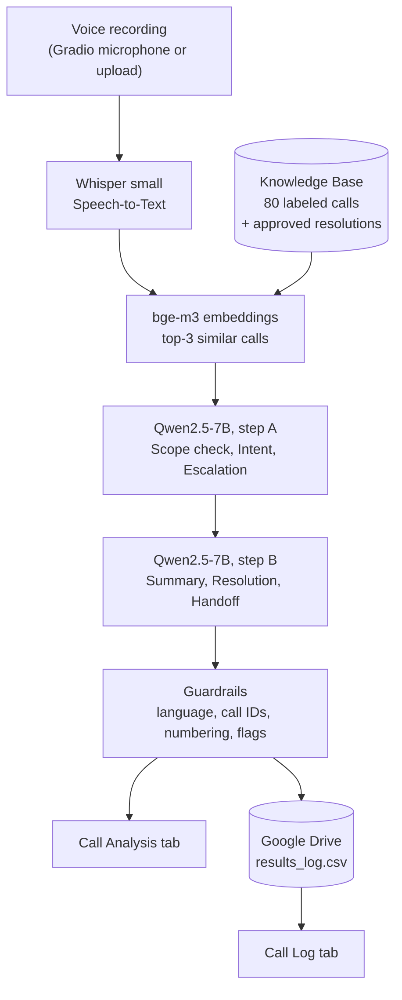

# CallSense: Technical Report

**Arabic Telecom Call-Center Intelligence** · Zenith Team · AI Engineering Bootcamp (AIEP), OLO Academy

> This report documents the final backend (`notebooks/CallSense_Backend.ipynb`): what we built, how data is stored and retrieved, why we chose each component, what went wrong along the way, and what is still limited.

## Contents

1. [Overview](#1-overview)
2. [Architecture](#2-architecture)
3. [Models](#3-models)
4. [Pipeline in detail](#4-pipeline-in-detail)
5. [Data and persistence on Google Drive](#5-data-and-persistence-on-google-drive)
6. [Human-in-the-loop review](#6-human-in-the-loop-review)
7. [Web interface and why Gradio](#7-web-interface-and-why-gradio)
8. [Engineering log: problems and fixes](#8-engineering-log-problems-and-fixes)
9. [Performance and evaluation](#9-performance-and-evaluation)
10. [Limitations and future work](#10-limitations-and-future-work)
11. [Glossary](#11-glossary-english--arabic)

---

## 1. Overview

CallSense analyzes customer-service calls of a telecom company. Given a voice recording, it returns, on one screen: the **transcript**, the **intent classification**, the **escalation decision**, a **summary**, and a **recommended resolution** (with a handoff note for the supervisor when escalation is required). The goal for quality analysts and managers: *less manual listening, earlier escalation signals, quick and reusable resolutions*.

## 2. Architecture



## 3. Models

| Stage | Model | Role | Notes |
|---|---|---|---|
| Speech-to-Text (ASR) | **Whisper small** (OpenAI, about 244M parameters) | Arabic audio to text | No fine-tuning. Only inference-time decoding configuration |
| Retrieval | **BAAI/bge-m3** | Multilingual embeddings for similarity search | Works well for Arabic |
| Reasoning and generation | **Qwen2.5-7B-Instruct** | Scope check, intent, escalation, summary, resolution | **4-bit quantization** (bitsandbytes) so it fits a free Colab T4 together with the other models |

All three run on one free Colab **T4 GPU**.

## 4. Pipeline in detail

### 4.1 Speech-to-Text (Whisper small)

- Language fixed to Arabic (`language="ar"`), `fp16` on GPU.
- **`baseline`** mode: the original configuration. **`tuned`** mode (default): `temperature=0` (deterministic), `beam_size=5` (beam search), `condition_on_previous_text=False`, and a short `initial_prompt` with telecom vocabulary.
- **Repetition guard**: Whisper can fall into a *repetition loop* (the same word repeated many times). The guard detects it (same word 6+ times, or an abnormal compression ratio) and retries with a `rescue` mode (temperature fallback), then `baseline`, and as a last resort collapses the repeated word.
- An **A/B test** cell compares `baseline` and `tuned` on the same recordings and can compute **WER**.

### 4.2 Knowledge Base and retrieval (RAG)

- The knowledge base (KB) holds the 80 labeled calls plus any human-approved calls.
- Every call text is embedded with bge-m3 (normalized vectors). A new call is embedded the same way and compared with **cosine similarity**; the top-3 most similar calls are returned (the call itself is excluded).
- When writing the resolution, calls of the same intent get a ranking bonus, and approved resolutions of those calls are given to Qwen as context.
- This is **Retrieval-Augmented Generation (RAG)**: Qwen works from real examples instead of inventing from scratch.

### 4.3 Intent and escalation (Qwen, scope-first)

1. **Scope check.** The model first writes the `topic` of the call and answers `telecom_related`: is the request about the telecom company's own services (lines, plans, internet, bills, cancellation, complaints about the company, its staff or branches)? Restaurants, delivery, banks, hospitals, general questions and translation requests are **not**, even if the customer is angry or the agent opens with "customer service".
2. If not telecom-related, the intent is `out_of_scope` and escalation is `0`. **The code enforces this**, whatever the model wrote elsewhere.
3. Otherwise it picks one of `billing`, `technical`, `cancellation`, `complaint`, `information`, and decides escalation using rules observed in the dataset (repeated or unresolved issue, broken company promise, clearly frustrated customer or cancellation threat, or a fix that needs higher authority).
4. Few-shot context: 3 static examples and the 3 nearest labeled calls from the KB.
5. Deterministic decoding (`do_sample=False`), JSON output, and a **fallback**: if the JSON is invalid or contradictory, the intent and escalation come from a vote of the nearest labeled calls (kNN voting).
6. Rule: `information` and `out_of_scope` calls are never escalated (matches the data).

### 4.4 Summary and resolution (Qwen)

A second, separate step receives the final intent and escalation and returns JSON with: `summary`, `solution_status` (clear, partial, not found), `applied_solution` (what the agent actually did), `recommended_solution` (steps), `escalation_handoff` (problem, what was tried, what is needed from the supervisor), `intent_check`, and `sources` (IDs of the similar calls used). Splitting the steps matters: the examples retrieved for the resolution depend on the correct intent.

### 4.5 Guardrails

| Guard | What it does |
|---|---|
| **Language guard** | Blocks Chinese, Japanese, Korean, Cyrillic and other foreign scripts, and requires mostly Arabic text. On failure it retries once with a stricter instruction, then cleans the text |
| **Source normalization** | Extracts call IDs (`[CS003]` becomes `CS003`) before comparing them with the retrieved calls |
| **Numbering strip** | Removes numbers the model puts in front of steps (the UI numbers them itself) |
| **Review flags** | The "Review Needed" box appears only for real reasons: invalid JSON, a cited call that was not retrieved, doubt about the intent, escalation without handoff note, non-Arabic output, or disagreement with similar calls |
| **No self-reported confidence** | We removed the LLM's "confidence" field, because it is text the model writes, not a measurement |

## 5. Data and persistence on Google Drive

A Colab runtime is **ephemeral**: it is wiped when the session disconnects. Google Drive is persistent, free, and mounts like a normal folder, so all state lives there (`/content/drive/MyDrive/CallSense/`).

| File | Content | Written |
|---|---|---|
| `Whisper_Small_Baseline_Results_with_Resolution.xlsx` | The 80 labeled calls (read-only source) | Manually |
| `results_log.csv` | One row per analyzed call (20 columns) | Automatically on every analysis |
| `approved_kb.csv` | Human-approved calls and resolutions | On `approve()` |
| `backups/` | Copies of the files above | Automatically before any delete, edit or clear |

**Lifecycle**

1. `drive.mount()` makes Drive visible to Colab.
2. On start-up the notebook reads the xlsx and `approved_kb.csv` (pandas), builds the `kb` table in memory, and computes the embeddings `kb_emb`.
3. After each analysis, `save_result()` appends a row to `results_log.csv` with a unique `record_id` (timestamp plus four hex characters). The file is UTF-8 with BOM so Arabic opens correctly in Excel.
4. The **Call Log** tab reads the file (`load_log()`), shows the latest 50 calls, refreshes every 20 seconds, and opens the full report when a row is selected.
5. If the log columns change, an automatic **schema migration** keeps the old rows.

**New calls are not added to the retrieval base automatically.** Only the 80 labeled calls and the calls a person approved are searched. This avoids a **feedback loop**: if a wrong answer entered the base unreviewed, the model would learn from it and repeat the error.

Limits of Drive as storage: it is bound to one Google account, and it is not designed for concurrent writes. A production version should use a database.

## 6. Human-in-the-loop review

Review tools run from the notebook (not from the public page, because anyone with the link could press a button):

```python
pending()                                                  # calls not reviewed yet
approve("R2026...")                                        # approve as is
approve("R2026...", edited_resolution="1. ...\n2. ...")    # approve with an edited resolution
approve("R2026...", intent="complaint", escalation=1)      # correct the label, then approve
reject("R2026...", notes="not accurate")
edit_record(...) · delete_record(...) · delete_before("2026-11-01 14:00") · clear_log(confirm=True) · backup_log()
```

Approval can **correct the intent and escalation**, because an approved call becomes a retrievable example. Deleting a call also removes it from the approved base and the in-memory index, and every destructive action takes a backup first.

## 7. Web interface and why Gradio

| | **Gradio** (chosen) | FastAPI + HTML | Streamlit |
|---|---|---|---|
| Microphone recording | Built in (`gr.Audio`) | Write JavaScript | Needs an extra component |
| Public link from Colab | One argument (`share=True`) | ngrok and CORS setup | Needs a tunnel |
| Project layout | One notebook | Separate backend and frontend | Separate app |
| Progressive results | `yield` (streaming) | Build it ourselves | Possible, but reruns the script |
| GPU hosting | Colab | A server | Free hosting has no GPU |

Features used: a **queue** (one analysis at a time on one GPU, up to 10 waiting), staged results (Transcribing, Classifying, Writing), two tabs (**Call Analysis**, **Call Log**), bilingual labels, custom CSS and an IBM Plex Sans Arabic font. Drawbacks: the public link is temporary (about 72 hours) and only works while the notebook runs, and customization is more limited than a hand-built frontend. A Streamlit or React frontend is a natural next step.

## 8. Engineering log: problems and fixes

| Problem | Cause | Fix |
|---|---|---|
| The TF-IDF classifier labeled complaint calls as `information` (about 28% confidence) in live tests | **Distribution shift**: 5-fold CV looked strong (macro-F1 0.95) on 80 similar calls, but new speakers and wording broke it | Replaced by a Qwen scope-first classifier. Kept as a documented baseline (`baseline_classifier/`) |
| Qwen could not correct the label | The prompt forbade it, and retrieval was filtered by the classifier's intent | Classification became its own step |
| Restaurant and delivery calls labeled as telecom | Narrow `out_of_scope` definition, and "customer service" in the greeting | Scope-first prompt, static examples, and enforcement in code |
| Chinese text in the UI | Qwen can drift to its primary language, and `repetition_penalty` pushes away tokens already in context (likely contributor) | Language guard and removing the penalty |
| "Review Needed" on almost every call | Sources came as `[CS003]` and did not match `CS003` | Source normalization |
| Double numbering ("1. 1.") | Model and UI both numbered | Numbering strip |
| "Confidence: High" on a wrong answer | Self-reported by the LLM | Removed |
| Whisper repeated "مرحبا" many times | Repetition loop; `temperature=0` alone disables Whisper's built-in fallback | Repetition guard with `rescue` mode |

## 9. Performance and evaluation

- **Latency.** About 42 s (desktop) and 53 s (mobile, includes upload) per call on a free Colab T4, measured during development before the final guards. Expect slightly more now (beam search, occasional retry).
- **Whisper small baseline.** Mean WER 0.443 on the 80 reference recordings (as stored in the dataset).
- **Baseline classifier.** 5-fold CV intent macro-F1 0.950; escalation F1 0.706 (0.837 with a tuned threshold). It did not generalize to new recordings (section 8).
- **Final system.** We have **no formal accuracy figure yet**. The notebook includes two evaluation tools: a 30-call evaluation on the dataset (with the call itself excluded from its own examples) and a 13-case "hard cases" suite (restaurant, delivery, bank, general question, plus difficult telecom cases). Running them gives a number to report.
- Whisper decoding A/B test (`baseline` vs `tuned`) is provided but has not been run yet.

## 10. Limitations and future work

**Limitations:** Whisper small struggles with dialect, noise and pauses; Qwen can still be wrong; the knowledge base is small (80 calls) and single-source; escalation rules are inferred from that data; one GPU processes one call at a time; the app only runs while the Colab session is alive; Drive is not concurrency-safe; the public page has no authentication; transcripts are stored in Drive.

**Future work:** persistent hosting (for example a Hugging Face Space with a GPU), a real database (SQLite or Supabase), an admin tab with a password, retraining a classifier with more diverse data, a larger or fine-tuned ASR model, evaluation on real call-center data, a manager dashboard, and a custom frontend (Streamlit or React) on top of the same backend.

## 11. Glossary (English / Arabic)

| Term | المعنى |
|---|---|
| Speech-to-Text (ASR) | تحويل الصوت إلى نص |
| Embedding | تمثيل رقمي (متجه) للنص |
| Retrieval-Augmented Generation (RAG) | توليد معزَّز بالاسترجاع من قاعدة معرفة |
| Few-shot prompting | تزويد الموديل بأمثلة داخل التعليمات |
| Quantization (4-bit) | ضغط الموديل ليعمل على ذاكرة أقل |
| Intent classification | تصنيف نية المكالمة |
| Escalation | التصعيد إلى المشرف |
| Out-of-scope | خارج نطاق الخدمة |
| Guardrails | ضوابط حماية للمخرجات |
| Human-in-the-loop | مراجعة بشرية ضمن الدورة |
| Feedback loop | حلقة تغذية راجعة (تعلّم الموديل من أخطائه) |
| Distribution shift | اختلاف توزيع البيانات الجديدة عن بيانات التدريب |
| WER (Word Error Rate) | نسبة الخطأ في الكلمات |
| Deterministic decoding | توليد ثابت (نفس المدخل، نفس المخرج) |
| Beam search | بحث الحزمة: يستكشف عدة احتمالات لاختيار الأدق |
